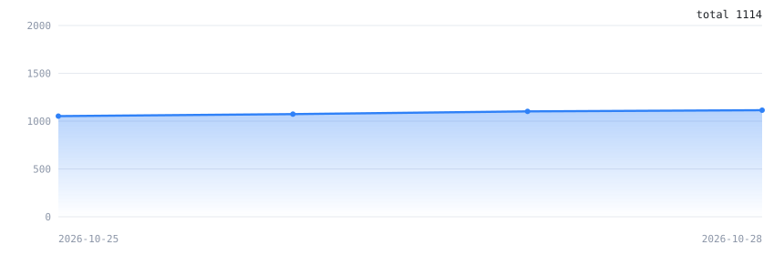

# GTA5 线上小助手 · DOG 二次开发版

基于原作者 **CrazyZhang** 的《GTA5 线上小助手》（MIT 许可）二次开发，作者：**DOG**。

> **本仓库 = 发布页 + 源码分支**：Releases 放成品，源码按组件分别开源（见下方「源码」章节）。

- 完全离线运行，只保留向本仓库 GitHub 接口查询新版本
- 内置简体中文 YimMenuV2 增强版菜单：百余项增强功能、30+ 类脚本事件防护、全量中文化
- 内置 FSL V6，一键离线安装
- 教程式界面与《关于 / 使用说明》弹窗，顶部导航带“联系”按钮
- 免安装单文件 exe，已内置 .NET 运行时，换电脑直接跑

## 下载

到 **[Releases](https://github.com/dogkka/GTA5OnlineTools-DOG/releases/latest)** 页下载最新版 exe。

更新方式：下载新的 exe 覆盖旧文件即可，配置和网上存档都不会丢。

Releases 里同时保留上一版：最新版万一有问题，可以先退回上一版用。

## 源码

本仓库只开源**增强版**相关代码，传承版（Legacy）在其它社区有大佬维护。

| 分支 | 内容 | 许可证 | 说明 |
|---|---|---|---|
| [`open-source`](https://github.com/dogkka/GTA5OnlineTools-DOG/tree/open-source) | **增强版菜单源码**（`NewBase.dll`） | GPL-2.0 | 基于 [YimMenu/YimMenuV2](https://github.com/YimMenu/YimMenuV2)；全量中文化、界面/防护/功能增强，改动清单见分支内 `CHANGES-VS-UPSTREAM.md` |
| [`tool-source`](https://github.com/dogkka/GTA5OnlineTools-DOG/tree/tool-source) | **纯净上游工具本体** | MIT | 来自 [sch-lda/GTA5OnlineTools](https://github.com/sch-lda/GTA5OnlineTools)，**不含 DOG 改造**、不含任何菜单 DLL；适合开发者做干净起点 |

说明：

- **DOG 二次开发版工具**为确保页面干净，（二维码、离线化、FSL 安装、环境自检等）已剔除源代码，只随 Release 发包。
- 传承版（Legacy）DLL、Lua 和相关文件**传承版不再维护，按许可证要求不发二进制、也不公开源码；想用请用社区上游其他大佬维护的版本**。
- 第三方组件与许可证明细见 [THIRD-PARTY.md](THIRD-PARTY.md)。

## 三步使用

1. **关闭反作弊**：Rockstar 启动器 → 设置 → 我的已安装游戏 → Grand Theft Auto V Enhanced → 取消勾选 **BattlEye**
   （Steam：启动项加 `-nobattleye`；**Epic 平台**：用程序内 FSL 管理里的「无BE模式启动游戏」或生成的桌面快捷方式）
2. **装 FSL**：程序 `YimMenu` 页 → `FSL管理` → 点 **一键安装FSL（自动检测）**（自动识别 Steam / Epic 与增强版；内置 FSL V6，离线安装）
3. **注入菜单**：游戏进到 **主菜单** → `YimMenu` 页 → 点 **内嵌版** → 游戏里按 `F7`（默认键，可自定义；备用 `Ctrl+\`）呼出中文菜单

## 更新检测

启动 1.5 秒后自动检查一次新版本；也可以在 **选项 → 检查更新** 或 **关于 → 检查更新** 手动检查。

检测只访问本仓库的 GitHub 接口，不碰任何第三方服务器。发现新版本会弹出提示（含更新内容），支持一键打开发布页面、复制下载链接、跳过此版本。

## 交流反馈

使用问题、反馈建议、更新通知都在群里；**主群、备用 1 群、备用 2 群均已满员，请直接加「备用 3 群」**：

<table>
  <tr>
    <th align="center">主群（已满）</th>
    <th align="center">备用 1 群（已满）</th>
    <th align="center">备用 2 群（已满）</th>
    <th align="center">备用 3 群（新群 · 推荐加入）</th>
  </tr>
  <tr>
    <td align="center"><b>472770575</b> </td>
    <td align="center"><b>1121769473</b> </td>
    <td align="center"><b>1129626000</b> </td>
    <td align="center"><b>1128353048</b> </td>
  </tr>
</table>

（群进满速度很快；也可以直接用群号搜索加群，已满的群无需尝试。）

**防诈骗提醒**：本项目完全免费、公益性质。如果你遇到收费，那就是被骗了，请务必联系卖软件给你的那个人退款；二改官方发布渠道只有本仓库的 Releases 页面。

## 数据

**下载量趋势**（每日快照累积）

**Star 增长**

## 参与贡献

- 欢迎有能力的开发者**一起参与共同开发**——提交 Pull Request 或 Issue 都欢迎；
- 如果你只是路过，也欢迎**顺手点一个 Star** 支持一下，这对我们是最大的鼓励。

## 许可

- 小助手工具本体：**MIT License**。纯净上游源码（不含 DOG 改造）已放在
  [`tool-source`](https://github.com/dogkka/GTA5OnlineTools-DOG/tree/tool-source) 分支；
  DOG 二次开发版：为确保页面干净，（二维码、离线化、FSL 安装、环境自检等）已剔除源代码，只随 Release 发包。。
- 内置的增强版菜单（`NewBase.dll`）：**GPL-2.0**，源码已开源，见
  [`open-source`](https://github.com/dogkka/GTA5OnlineTools-DOG/tree/open-source) 分支
  （基于 [YimMenu/YimMenuV2](https://github.com/YimMenu/YimMenuV2)，汉化/优化/新增功能见该分支 `CHANGES-VS-UPSTREAM.md`）。
- 传承版 YimMenu DLL：历史版本曾内置（GPL-2.0，[Mr-X-GTA/YimMenu](https://github.com/Mr-X-GTA/YimMenu)）；**新版本起不再分发**。
- 内置 FSL V6：来自 UnknownCheats 帖子 616977（作者发布，未见公开源码）。

完整的第三方组件、许可证与源码状态见 **[THIRD-PARTY.md](THIRD-PARTY.md)**；GPL-2.0 全文见 [`LICENSES/GPL-2.0.txt`](LICENSES/GPL-2.0.txt)。

> 本仓库只开源**增强版菜单**，传承版（Legacy）相关代码/文件不上传。
